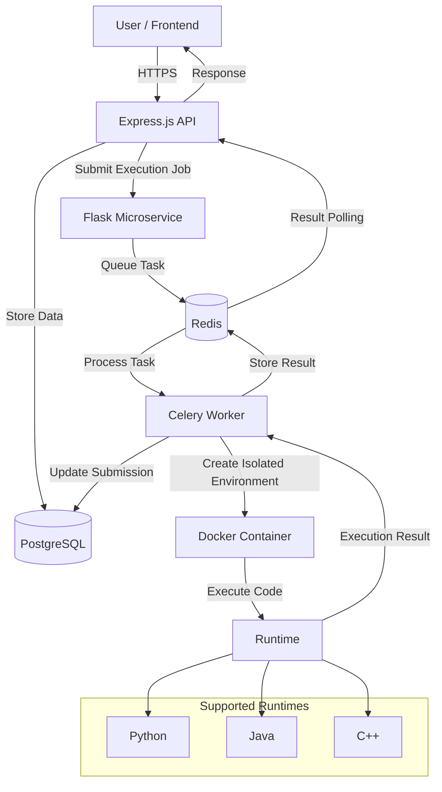

# Online Judge Platform

A comprehensive online competitive programming platform built with a modern microservices architecture, featuring automated code execution, containerized runtimes, real-time submission results, contests, and scalable background workers.

## Demo
https://private-user-images.githubusercontent.com/175551506/634070612-4d1bf1d7-d6e5-4658-b608-58bfb94dd4a3.mp4?jwt=eyJ0eXAiOiJKV1QiLCJhbGciOiJIUzI1NiJ9.eyJpc3MiOiJnaXRodWIuY29tIiwiYXVkIjoicmF3LmdpdGh1YnVzZXJjb250ZW50LmNvbSIsImtleSI6ImtleTUiLCJleHAiOjE3ODY0MjkzNDgsIm5iZiI6MTc4NjQyOTA0OCwicGF0aCI6Ii8xNzU1NTE1MDYvNjM0MDcwNjEyLTRkMWJmMWQ3LWQ2ZTUtNDY1OC1iNjA4LTU4YmZiOTRkZDRhMy5tcDQ_WC1BbXotQWxnb3JpdGhtPUFXUzQtSE1BQy1TSEEyNTYmWC1BbXotQ3JlZGVudGlhbD1BS0lBVkNPRFlMU0E1M1BRSzRaQSUyRjIwMjYwODExJTJGdXMtZWFzdC0xJTJGczMlMkZhd3M0X3JlcXVlc3QmWC1BbXotRGF0ZT0yMDI2MDgxMVQwNjE3MjhaJlgtQW16LUV4cGlyZXM9MzAwJlgtQW16LVNpZ25hdHVyZT03NGFjYmQ1M2UwMTk0ZjQ2NDExNmQ4YzYzZjNhYzlkZmZiZGI5OTY4N2M5NTYxZWY3ZmMzNjk5YzAwNDgzNWUyJlgtQW16LVNpZ25lZEhlYWRlcnM9aG9zdCZyZXNwb25zZS1jb250ZW50LXR5cGU9dmlkZW8lMkZtcDQifQ.F9x1BL4DjwIG4xISWIK-Gfxd4Z_kHaWheaswipbMLTQ

---

## Platform Highlights

* **Online Code Execution** - Users submit solutions in more than one language and the platform runs them.
* **Microservices Architecture** - API requests, job queues, and program execution are handled by separate services.
* **Containerized Execution** - Each submitted program runs inside its own Docker container.
* **Real-Time Results** - Submission status and run outcomes are returned as they become available.
* **Competitive Programming** - The site includes problems, submissions, contests, and leaderboards.
* **Team Competitions** - Contests can be entered by teams working together.
* **Secure Authentication** - Sign-in and access control use JSON Web Tokens.
* **Scalable Execution** - Background workers can judge several submissions at the same time.

---

## Technology Stack

<div align="center">


</div>

### Backend

* **Node.js + Express.js** - The main API. It covers sign-in, problems, contests, and submissions.
* **Flask** - A separate service that accepts execution requests and places them on a queue.
* **Celery** - A distributed queue that carries out code-execution jobs.
* **PostgreSQL** - Long-term storage for users, problems, contests, and submissions.
* **Redis** - Message broker, plus storage for results and cached data.

### DevOps & Infrastructure

* **Docker & Docker Compose** - Packages each service and starts them together.
* **Google Cloud Platform** - Hosts the application.
* **Let's Encrypt** - Issues the SSL certificates.
* **GoDaddy** - Manages the domain and DNS.

---

## System Architecture


---

## Features

### User Management

* Account registration
* Sign-in
* Authorization with JWTs
* Profile management
* Submissions tied to a specific user

### Problem Management

* Browse the problem list
* Add a problem
* Update a problem
* Remove a problem
* Group programming challenges
* Check a solution against a fixed set of test cases

### Multi-Language Code Execution

Submitted programs can be run in more than one language, including:

* C++
* Python
* Java

Every submission runs in a runtime kept separate from the rest of the system.

### Online Judge

Submitted code is checked against the problem's test cases, and that check produces a final verdict.

Possible verdicts:

* Accepted
* Wrong Answer
* Runtime Error
* Time Limit Exceeded
* Compilation Error

### Contests

* Create a contest
* Enter a contest
* Attach problems to a contest
* Track submissions
* Show standings while a contest is running
* Rank participants on a leaderboard

### Team Competitions

Contests can also be run for teams, so several users can compete together on the same entry.

### Leaderboards

Rankings update from contest results and from submissions.

### Security

* Authentication with JWTs
* Authorization by role
* Hashed passwords
* Execution kept apart from the host
* A Docker sandbox around each run
* Limits on the resources a program may use
* Traffic sent over HTTPS

---

## Docker Architecture

The application is made up of several services.

```text
                 ┌──────────────────┐
                 │    Frontend      │
                 └────────┬─────────┘
                          │
                          ▼
                 ┌──────────────────┐
                 │  Express API     │
                 └───────┬──────────┘
                         │
              ┌──────────┴──────────┐
              ▼                     ▼
       ┌──────────────┐      ┌──────────────┐
       │ PostgreSQL   │      │    Flask     │
       └──────────────┘      └──────┬───────┘
                                    │
                                    ▼
                              ┌────────────┐
                              │   Redis    │
                              └─────┬──────┘
                                    │
                                    ▼
                              ┌────────────┐
                              │   Celery   │
                              │   Worker   │
                              └─────┬──────┘
                                    │
                                    ▼
                            ┌─────────────────┐
                            │ Docker Sandbox  │
                            │                 │
                            │ C++ / Java /    │
                            │ Python          │
                            └─────────────────┘
```

Adding more workers lets more execution jobs run at the same time.

---

## Code Execution Security

An online judge has to run programs that users wrote, and that code cannot be trusted. That is one of the central problems this kind of system has to solve.

Isolation here is done with Docker.

Each submission gets its own container, so the program cannot reach the host directly.

That environment can limit or control:

* CPU use
* Memory use
* How long the program may run
* What it can do with the filesystem
* Whether it can use the network
* Removal of the container once the run ends

The result is a safer place to run code that did not come from the platform itself.

---

## Scalability

Because execution is asynchronous, many submissions can be in progress while the main API keeps answering requests.

Programs are not run inside the API process:

```text
User
 │
 ▼
API Server
 │
 ▼
Queue
 │
 ├── Worker 1
 ├── Worker 2
 ├── Worker 3
 └── Worker N
```

More workers can be started when more submissions arrive.

That lets the execution tier, which does the heavy computing, grow by adding workers.

---

## Data Storage

PostgreSQL is the main database, and the data stored there is kept permanently.

Records kept there include:

* Users
* Problems
* Test cases
* Contests
* Teams
* Submissions
* Submission results
* Contest standings

Redis handles:

* Queuing tasks
* Holding execution results for a short time
* Reading those results quickly
* Passing information between the pieces that run code

---

## Performance Considerations

Handling an incoming request and actually running the submitted program are separate steps.

A submission that takes a long time therefore does not stall the API.

The main techniques used for speed are:

* Asynchronous task processing
* Queues backed by Redis
* More than one Celery worker
* Indexes on the database
* Running programs in containers
* Caching results
* Adding workers as load grows

---

## Key Engineering Challenges

### 1. Running Untrusted Code

User programs have to be executed without letting them damage the machine they run on.

**Solution:** Isolated Docker environments that also cap resource use.

### 2. Long-Running Submissions

Judging a program often takes much longer than a typical API call.

**Solution:** Hand that work to Celery workers that run asynchronously.

### 3. Concurrent Submissions

Several people can submit at the same time.

**Solution:** Queues in Redis, with workers that can be scaled out.

### 4. Reliable Result Retrieval

The API needs to stay responsive while workers are still judging.

**Solution:** Keep execution state and results in a separate store, and read them back asynchronously.

### 5. Deployment

The project is made of several services that run on their own.

**Solution:** Docker Compose starts them together, and GitHub Actions deploys them automatically.

---

## High-Level Architecture

```text
my-online-judge/
│
├── backend/
│   ├── controllers/
│   ├── routes/
│   ├── models/
│   ├── middleware/
│   └── services/
│
├── frontend/
│
├── flask-service/
│
├── worker/
│
├── docker/
│
├── docker-compose.yml
├── .env.example
└── README.md
```

> Update the tree above so it matches the layout of this repository.

---
## Inspiration

The design follows ideas from existing competitive programming sites, including:

* Codeforces
* LeetCode
* AtCoder
* HackerRank

The aim is a contest-style interface on top of a backend that can grow with load and can run untrusted code safely.

---

---

**Online Judge Platform**

</div>
